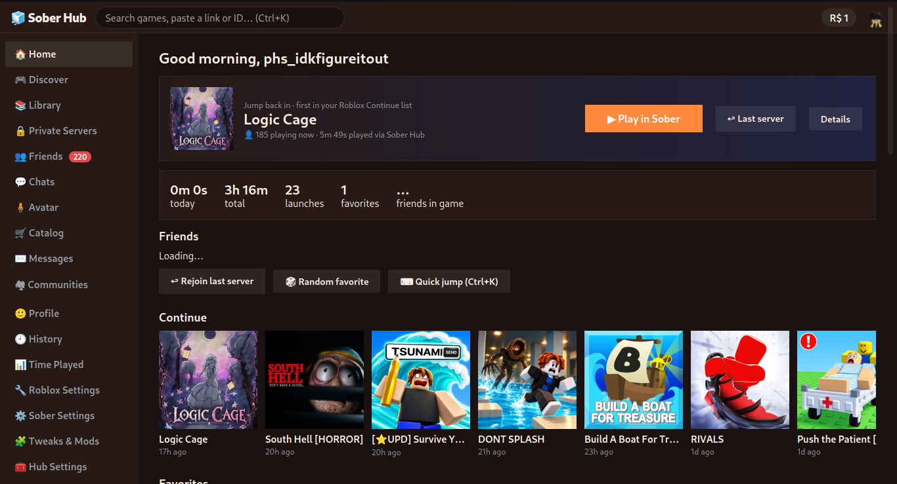

> ### ⚠️ WARNING & DISCLAIMER
> **This app was written with Claude AI and tested by a human. It can use your Roblox login cookie. Use it at your own risk.**
> - Run it only on your own computer. **Never host it on a cloud server or expose it to a network.**
> - **I am not responsible for any bans, lost items, lost Robux or anything else caused by this software.**
> - Sober Hub is an unofficial community project. It is not affiliated with or endorsed by Roblox or the Sober / VinegarHQ team.

<h1 align="center">🧊 Sober Hub</h1>

<p align="center">
  <b>The missing front end for Sober (Roblox on Linux).</b><br>
  Friends, avatar, servers, tweaks and stats, in one fast local app.<br>
  One Python file · no dependencies · no Electron · no telemetry
</p>

<p align="center">
  <a href="https://soberhub-web.vercel.app"><b>🌐 Live demo (mockup)</b></a> ·
  <a href="#-quick-start">Quick start</a> ·
  <a href="#-what-makes-it-different">What's different</a> ·
  <a href="#-security--privacy">Security</a>
</p>



*Sober Hub with the Sunset theme preset.* The [live demo](https://soberhub-web.vercel.app) is a mockup with sample data, not the real app.

---

**Sober Hub** is a lightweight launcher and companion desktop app for [**Sober**](https://sober.vinegarhq.org/) (Roblox on Linux). Sober runs Roblox; Sober Hub is everything around it: a Roblox-style home for launching games, seeing and joining friends, managing your avatar and private servers, tweaking Sober, and tracking your playtime. It is a single Python file with no required dependencies.

## 🔥 What makes it different

| | |
|---|---|
| 🔁 **Rejoin last server that actually works** | Press plain Play and the hub works out which server you landed in and remembers it, so **Rejoin last server** works for every launch, not just ones started from a link. *(Needs a connected account.)* |
| 🏠 **Back to the hub when you leave a game** | Sober normally drops you on its own home screen. For games started from the hub, the hub turns on Sober's `close_on_leave`, brings its window to the front when you exit, and restores your own setting afterwards (even if the hub was closed mid-game). |
| 🔔 **Live friend notifications** | Animated cards with avatar, game icon, sound and a **Join** button when a friend starts playing or comes online, plus real desktop notifications through `notify-send`. Pinned friends or everyone. Glitchy "everyone went offline" polls are ignored, so no notification floods. |
| 🎯 **Recommendations you control** | Built-in picks ranked locally from your own history, Roblox's own sorts, or **your own recommendations API**. Right-click any game to hide it. |
| 🔒 **A real private server manager** | Join servers you own or rent, create, rename, manage members and friend access, lock down or open up, regenerate the link, manage renewal. |
| 🧩 **Tweaks that stick** | Sober rewrites its config on exit and can undo your changes. The hub closes Sober first, writes the change and reads it back to confirm. |
| 🕵️ **Complete profile lookup** | Online status, avatar, about, past usernames, social links, badges, what they're wearing, groups, **every** friend (not just the first 200), experiences, favorites and recent badges. |
| 🛡️ **Private by design** | Local only, no analytics, no cloud. Log in with **Quick Login** so no password or cookie has to be typed. |

### How it compares
# How it compares

**Sober Hub v5.6.0** vs. Roblox in a browser vs. **Sober on its own**. Sober is a Linux runtime for the **Roblox Android app**, so the "Sober on its own" column is what the Roblox Android app gives you. Every feature in the hub is listed, and Party is not included.

Legend: ✅ yes · ❌ no · 🟡 partly / manual (see note)

---

## Core (the headline features)

| | Roblox in a browser | Sober on its own (Roblox Android app) | **Sober Hub** |
|---|:-:|:-:|:-:|
| Launch games in Sober | ✅ | ✅ | ✅ |
| Friends online + one-click join | ✅ | ✅ | ✅ |
| Live pop-up + desktop friend alerts | ❌ | ❌ | ✅ |
| Rejoin last server (even after plain Play) | ❌ | ❌ | ✅ |
| Returns to the launcher when you leave a game | ❌ | ❌ | ✅ |
| Avatar editor with outfits and undo | ✅ (no undo) | ✅ (no undo) | ✅ |
| Private server manager | ✅ | 🟡 join, limited management | ✅ |
| Fast Flag editor + mods with safe apply | ❌ | 🟡 manual file edit | ✅ |
| Local playtime stats and streaks | ❌ | ❌ | ✅ |
| Custom recommendations API | ❌ | ❌ | ✅ |
| Custom themes and CSS | ❌ | ❌ | ✅ |

---

## Launching & Games

| | Roblox in a browser | Sober on its own | **Sober Hub** |
|---|:-:|:-:|:-:|
| Quick launch from a pasted `roblox.com/games` link, `roblox://` link or place ID | 🟡 via the site | 🟡 only through a link opened from outside | ✅ |
| Private-server links accepted by quick launch | ✅ | 🟡 only through a link opened from outside | ✅ |
| Game search | ✅ | ✅ | ✅ |
| 🎲 Surprise me (random game from recommendations) | ❌ | ❌ | ✅ |
| 🎲 Random favorite | ❌ | ❌ | ✅ |
| Game page: rating, playing, visits, favorites, creator, description | ✅ | ✅ | ✅ |
| 👍 / 👎 vote and favorite on Roblox | ✅ | ✅ | ✅ |
| Copy game link / copy `roblox://` launch link | 🟡 link only | 🟡 share link only | ✅ |
| Open game on roblox.com | n/a | ❌ | ✅ |
| Friends playing this game, with one-click join | ✅ | ✅ | ✅ |
| Per-game private notes | ❌ | ❌ | ✅ |
| Public server browser (emptiest, fullest, best ping, load more) | 🟡 basic list | ❌ | ✅ |
| 🎲 Random public server | ❌ | ❌ | ✅ |
| 🔀 Server hop (skips recent, full and empty servers, prefers low ping) | ❌ | ❌ | ✅ |
| Rejoin the last server of any game | ❌ | ❌ | ✅ |
| Roblox "Continue" list shown on Home | ✅ | ✅ | ✅ |
| Hero card to jump back into your last game | ❌ | 🟡 Continue row only | ✅ |
| Home hero choice (last hub launch vs. first Roblox Continue game) | ❌ | ❌ | ✅ |
| Launch command editor (presets: Default, GameMode, Dedicated GPU) | n/a | 🟡 type it in a terminal | ✅ |

---

## Library & Organization

| | Roblox in a browser | Sober on its own | **Sober Hub** |
|---|:-:|:-:|:-:|
| Favorites | ✅ | ✅ | ✅ |
| Reorder favorites (move to front) | ❌ | ❌ | ✅ |
| 🕒 Play later list (leaves the list when you play it) | ❌ | ❌ | ✅ |
| Custom collections / folders of games | ❌ | ❌ | ✅ |
| Notes overview for all games | ❌ | ❌ | ✅ |
| Launch history with filter, delete and clear | 🟡 recently played only | 🟡 recently played only | ✅ |
| Hide games from recommendations (and unhide) | ❌ | ❌ | ✅ |
| Hidden items manager | ❌ | ❌ | ✅ |

---

## Discover & Recommendations

| | Roblox in a browser | Sober on its own | **Sober Hub** |
|---|:-:|:-:|:-:|
| Roblox's own Discover sorts | ✅ | ✅ | ✅ |
| "Better recommendations" (trending, hidden gems, matched to your history via Rolimons) | ❌ | ❌ | ✅ |
| Custom recommendations API (GET/POST, headers, body, JSON path, placeholders) | ❌ | ❌ | ✅ |
| Test button for your API | ❌ | ❌ | ✅ |
| Automatic fallback if the recommendations API is down | ❌ | ❌ | ✅ |
| Choose the recommendation source | ❌ | ❌ | ✅ |

---

## Friends & Social

| | Roblox in a browser | Sober on its own | **Sober Hub** |
|---|:-:|:-:|:-:|
| Friends list with online / in-game / Studio status | ✅ | ✅ | ✅ |
| Filter friends by name or game, sort by status or name | 🟡 | 🟡 | ✅ |
| Pin friends (⭐) | ❌ | ❌ | ✅ |
| Last online time, remembered by the hub | ❌ | ❌ | ✅ |
| "Was playing …" last game for offline friends | ❌ | ❌ | ✅ |
| Offline friends sorted by most recently online | ❌ | ❌ | ✅ |
| Recent activity feed (came online, started a game, went offline) | ❌ | ❌ | ✅ |
| Friend nicknames (only shown in the hub) | ❌ | ❌ | ✅ |
| Add friend by username | ✅ | ✅ | ✅ |
| Add several people at once | ❌ | ❌ | ✅ |
| Friend requests: accept / decline | ✅ | ✅ | ✅ |
| Bulk accept / decline all requests | 🟡 | ❌ | ✅ |
| Friend card (Join, View game, Profile) | ✅ | ✅ | ✅ |
| Right-click friend menu | ❌ | ❌ | ✅ |
| Friends CSV export (with last online and last game) | ❌ | ❌ | ✅ |
| Window title shows how many friends are in a game | ❌ | ❌ | ✅ |

---

## Notifications & Wellbeing

| | Roblox in a browser | Sober on its own | **Sober Hub** |
|---|:-:|:-:|:-:|
| Animated friend pop-up cards with a Join button | ❌ | ❌ | ✅ |
| Notify: Off / Pinned friends only / All friends | ❌ | ❌ | ✅ |
| Also notify when friends come online | ❌ | ❌ | ✅ |
| Chime sound | ❌ | ❌ | ✅ |
| Desktop notification when the app is in the background | 🟡 browser notifications | ❌ no push notifications on Linux | ✅ |
| Test notification button | ❌ | ❌ | ✅ |
| Quiet hours | ❌ | ❌ | ✅ |
| Protection against false "everyone went offline" floods | ❌ | ❌ | ✅ |
| Break reminders (every 30 to 120 min) | ❌ | ❌ | ✅ |
| Daily play limit | 🟡 Roblox Parental Controls | 🟡 Roblox Parental Controls | ✅ |
| Welcome-back message when Sober closes | ❌ | ❌ | ✅ |

---

## Chats, Messages, Communities & Profiles

| | Roblox in a browser | Sober on its own | **Sober Hub** |
|---|:-:|:-:|:-:|
| Roblox chat (read and send) | ✅ | ✅ | ✅ |
| Unread chat badge | ✅ | ✅ | ✅ |
| Message a friend straight from the friends list | ✅ | ✅ | ✅ |
| Hide chats from specific players (hub only) | ❌ | ❌ | ✅ |
| Messages: Inbox, Sent, Archive | ✅ | ❌ | ✅ |
| Communities (groups) list | ✅ | ✅ | ✅ |
| Profile lookup for any username | ✅ | ✅ | ✅ |
| Friend / follower / following counts | ✅ | ✅ | ✅ |
| Mutual friends list with count | ❌ | 🟡 | ✅ |
| Last location and last game seen on a profile | 🟡 | 🟡 | ✅ |
| Add friend, accept request, follow, copy link from a profile | ✅ | ✅ | ✅ |
| "Join in Sober" straight from a profile | ❌ | ✅ | ✅ |

---

## Avatar & Catalog

| | Roblox in a browser | Sober on its own | **Sober Hub** |
|---|:-:|:-:|:-:|
| Live avatar render (Full / Bust / Head) | ✅ | ✅ | ✅ |
| Wear / remove items, wear bundles | ✅ | ✅ | ✅ |
| Wardrobe by category with search | ✅ | ✅ | ✅ |
| Switch avatar type (R6 / R15) | ✅ | ✅ | ✅ |
| Body scales and skin tone | ✅ | ✅ | ✅ |
| Outfits: view, wear, save, rename, delete | ✅ | ✅ | ✅ |
| ↩ Undo avatar changes | ❌ | ❌ | ✅ |
| Remove all accessories in one click | 🟡 | 🟡 | ✅ |
| Catalog / Avatar Shop search and buy | ✅ | ✅ | 🟡 opens the roblox.com catalog |

---

## Private Servers

| | Roblox in a browser | Sober on its own | **Sober Hub** |
|---|:-:|:-:|:-:|
| Servers you own or rent, with Join | ✅ | ✅ | ✅ |
| Manage: rename, members, invite link, friend access, new link, renewal on/off | ✅ | 🟡 limited | ✅ |
| Create a private server from the game page | ✅ | ✅ | ✅ |
| Local saved private-server links with labels, grouped by game | ❌ | ❌ | ✅ |
| Add a saved link from any game page or right-click menu | ❌ | ❌ | ✅ |

---

## Playtime & Stats

| | Roblox in a browser | Sober on its own | **Sober Hub** |
|---|:-:|:-:|:-:|
| Time played: total, today, last 7 days | ❌ | ❌ | ✅ |
| Play streak | ❌ | ❌ | ✅ |
| Most-played game | ❌ | ❌ | ✅ |
| 14-day bar chart | ❌ | ❌ | ✅ |
| Per-game time, launches, longest session, last played | ❌ | ❌ | ✅ |
| Live timer for the running game in the top bar | ❌ | ❌ | ✅ |
| Playtime CSV export | ❌ | ❌ | ✅ |
| Reset playtime | ❌ | ❌ | ✅ |

---

## Sober Settings & Tweaks

| | Roblox in a browser | Sober on its own | **Sober Hub** |
|---|:-:|:-:|:-:|
| Sober install status, version, running state | n/a | 🟡 terminal | ✅ |
| Update Sober / stop Sober from the UI | n/a | 🟡 terminal (Flatpak) | ✅ |
| Open Sober's config folder | n/a | 🟡 file manager | ✅ |
| Discord Rich Presence toggle | n/a | 🟡 config file | ✅ |
| OpenGL renderer, HiDPI, touch mode toggles | n/a | 🟡 config file | ✅ |
| Gamepad access, close-on-leave toggles | n/a | 🟡 config file | ✅ |
| Server location indicator toggle | n/a | 🟡 config file | ✅ |
| Old "oof" death sound toggle | n/a | 🟡 config file | ✅ |
| FPS cap and frame rate cap presets | n/a | 🟡 manual flag | ✅ |
| Fast Flag presets: MSAA, texture quality, lighting, graphics level, DPI fix, Alt+Enter fix | n/a | 🟡 manual flag | ✅ |
| Fast Flag editor: add, change, remove single flags | n/a | 🟡 manual file edit | ✅ |
| Import / download / copy flag JSON | n/a | ❌ | ✅ |
| Reset all flags in one click | n/a | ❌ | ✅ |
| Warns you when Sober is running, so it can't overwrite your changes | n/a | ❌ | ✅ |

---

## Mods

| | Roblox in a browser | Sober on its own | **Sober Hub** |
|---|:-:|:-:|:-:|
| Old avatar background mod (one click, downloaded from GitHub) | n/a | 🟡 manual files in the asset overlay | ✅ |
| Old character sounds mod | n/a | 🟡 manual files | ✅ |
| Cursor styles (2013, 2006) | n/a | 🟡 manual files | ✅ |
| Emoji fonts (Catmoji, Windows 11, 10, 8.1) | n/a | 🟡 manual files | ✅ |
| Custom font (.ttf, .otf, .ttc) | n/a | 🟡 manual files | ✅ |
| Custom death sound (.ogg) with audio format check | n/a | 🟡 manual files | ✅ |
| Custom arrow / far cursor images | n/a | 🟡 manual files | ✅ |
| Custom file paths in the asset overlay | n/a | 🟡 manual files | ✅ |
| List, remove, remove-all mods; open overlay folder | n/a | ❌ | ✅ |
| Safe apply (conflict warnings, format checks, nothing installed under the wrong format) | n/a | ❌ | ✅ |

---

## Roblox Account Settings

| | Roblox in a browser | Sober on its own | **Sober Hub** |
|---|:-:|:-:|:-:|
| Account Info, Security, Privacy, Parental Controls, Notifications, Billing | ✅ | ✅ | 🟡 shortcuts that open roblox.com |
| Edit About me and display name | ✅ | ✅ | ✅ |
| Chat and inventory privacy settings | ✅ | ✅ | ✅ |
| Robux balance shown | ✅ | ✅ | ✅ |

---

## Customization

| | Roblox in a browser | Sober on its own | **Sober Hub** |
|---|:-:|:-:|:-:|
| Theme presets (Roblox Dark, Roblox Light, Amoled, Rose, Sunset, Ocean, Forest, Purple, Mono) | 🟡 light / dark | 🟡 light / dark | ✅ |
| Color pickers (background, panel, accent, green, text) | ❌ | ❌ | ✅ |
| Corner radius, font and tile size | ❌ | ❌ | ✅ |
| Compact layout | ❌ | ❌ | ✅ |
| Custom CSS editor with live preview and template | ❌ | ❌ | ✅ |
| Local `file://` background images in custom CSS | ❌ | ❌ | ✅ |

---

## Quality of Life

| | Roblox in a browser | Sober on its own | **Sober Hub** |
|---|:-:|:-:|:-:|
| Ctrl+K quick jump (tabs, games, pasted links, search) | ❌ | ❌ | ✅ |
| `/` focuses the search bar | ❌ | ❌ | ✅ |
| Right-click game menu | ❌ | ❌ | ✅ |
| Right-click empty-space menu | ❌ | ❌ | ✅ |
| 🩺 Health check (Sober, Roblox session, connection, optional tools) | ❌ | ❌ | ✅ |

---

## Login, Data & Updates

| | Roblox in a browser | Sober on its own | **Sober Hub** |
|---|:-:|:-:|:-:|
| Quick Login with a code (no password typed in the app) | ✅ | ✅ | ✅ |
| Cookie login | ❌ | ❌ | ✅ |
| Public-profile-only mode | ✅ | ❌ | ✅ |
| Cookie stored locally and only sent to `*.roblox.com` | n/a | n/a | ✅ |
| Local-only server (127.0.0.1) with Host/Origin checks | n/a | n/a | ✅ |
| Backup export / import (never includes your cookie) | ❌ | ❌ | ✅ |
| Auto-update from GitHub (syntax-checked, old file kept as `.bak`) | n/a | 🟡 Flatpak updates only | ✅ |
| "What's new" pop-up and update log | ❌ | ❌ | ✅ |
| Native window or browser app window, desktop shortcut install | n/a | n/a | ✅ |

---

*Notes: "Roblox in a browser" means roblox.com. "Sober on its own" means the Roblox Android app running through Sober without Sober Hub; 🟡 entries there can be done only by editing config files or flags by hand, typing terminal commands, or in a limited way. Block / Unblock is intentionally not in Sober Hub, because Roblox rejects it from outside the official app.*
## ✨ Features

* 🎮 **Launcher & Quick Join:** Launch by place ID, `roblox.com/games` link, `roblox://` link or private-server link. Browse public servers (emptiest, fullest, best ping, random) and join a friend's server directly.
* 💎 **Better Recommendations (default):** *Picked for you*, *Trending now*, *Hidden gems* and *More <your top genre>*, built from the community-made Rolimons game list plus Roblox's own APIs. Switch to Roblox's recommendations or your own API (see [Recommendations](#-recommendations)).
* 🧍 **Avatar Editor:** Live render with Full / Bust / Head views, wardrobe by item type, instant wear and remove, **Undo**, saved outfits (wear, rename, delete, save current), skin tones, R6/R15, body scales and **bundles**.
* 👥 **Friends & Social:** Online status and in-game location for every friend, pinning, search, join-in-their-server, friend requests (accept or decline all, send in bulk) and the notifications above.
* 🕵️ **Profiles & Blocking:** Full profile lookup, with Add friend / Message / Join / Follow. **Block and Unblock** on your real Roblox account, with a Blocked users list.
* 💬 **Chat & Messages:** Roblox chat with unread badges, hide chats from specific people, inbox/sent/archive messages, and account privacy toggles.
* 🔒 **Private Servers:** Save and label links, list and join servers you own or rent (each shows which game it is for), create new ones and manage them.
* ⚙️ **Tweaks & Mods:**
  * Fast flags: MSAA, texture quality, display scaling, FPS cap, lighting technology, graphics level, no shadows, no post-processing, no grass, plus a full **Fast Flag editor** with import/export.
  * Mods: **old "oof" death sound**, old avatar background, old character sounds, 2006 / 2013 cursors, emoji fonts, custom font, and a custom file overlay for anything under `content/`.
* 🛠 **Sober Settings:** Edit Sober's own options and fast flags, update Sober, force-quit it, open its config folder, and pick launch-command presets (GameMode, dedicated GPU).
* 📊 **Playtime Analytics:** Total, daily and per-game playtime, a 14-day chart, play streak, longest sessions, and CSV export.
* 📚 **Library:** Favorites, collections, history, per-game notes, hidden games, and a "Surprise me" button.
* 🎨 **Style & CSS:** Presets (Roblox Dark/Light, Amoled, Rose, Sunset, Ocean, Forest, Purple, Mono), accent/radius/font/tile-size controls, compact mode and live custom CSS.
* ⌨️ **Quick-jump palette:** `Ctrl+K` jumps to any tab or game, or paste a link or ID. `/` focuses search, right-click menus work on games, friends and chats.
* 🔄 **Auto-update:** Checks GitHub on start and every 6 hours, verifies the download, installs it, keeps the old file as `sober_hub.py.bak` and shows what's new. Turn it off in Hub Settings or run with `--no-update`.
* 🛒 **Catalog:** Opens roblox.com/catalog in your browser.

## 📋 Prerequisites

* **Linux** with **Python 3.8+**
* [**Flatpak**](https://flatpak.org/) with Sober installed:
  ```bash
  flatpak install flathub org.vinegarhq.Sober
  ```
* *(Optional, recommended)* **pywebview** for a native window instead of a browser app window. See [`requirements.txt`](requirements.txt) for the GUI backend it needs on Linux:
  ```bash
  pip install -r requirements.txt
  ```
  If pywebview is installed but has no GUI backend, Sober Hub falls back to the browser window automatically.
* *(Optional)* `notify-send` (libnotify) for desktop notifications while the hub is in the background.

## 🚀 Quick Start

1. Get the code:
   ```bash
   git clone https://github.com/Phsyt/Sober-hub-.git
   cd Sober-hub-
   ```

2. Run it:
   ```bash
   python3 sober_hub.py
   ```
   * With pywebview installed it opens as a native window.
   * Otherwise it opens an app window in Brave, Chromium, Chrome or Edge (whichever it finds first), or your default browser.
   * Add `--browser` to force the browser window, or `--no-update` to skip the update check.

3. *(Optional)* Add a desktop shortcut:
   ```bash
   python3 sober_hub.py --install
   ```
   This writes a launcher and icon to `~/.local/share/`, so Sober Hub appears in your app menu. If you move the script, run this again.

4. *(Optional)* Open **🔗 Hub Login** to unlock friends, chat, avatar, private servers and messages. Without it you can still use the launcher, discovery, tweaks, playtime stats and public profile lookups.
   * **Quick Login (recommended):** the hub shows a code, you confirm it on `roblox.com/crossdevicelogin/ConfirmCode` while logged in there. No password or cookie is typed into the hub.
   * **Cookie:** paste your `.ROBLOSECURITY` cookie.

> Playing still uses Sober's own login. Open Sober once and sign in there.

## 💎 Recommendations

Choose the source in **🧰 Hub Settings → Recommendations**:

| Option | What it does |
|---|---|
| **Better recommendations** (default) | Rolimons list plus Roblox data: *Picked for you*, *Trending now*, *Hidden gems* and *More <your top genre>*. |
| **My own API** | Your endpoint, GET or POST (see below). |
| **Normal Roblox recommendations** | Roblox's own Discover sorts. |

"Picked for you" ranks games by how well their genre matches your favorites, playtime and launch history, plus like ratio and a small popularity term. The ranking runs on your machine, and nothing about you is sent to Rolimons. If a source fails, Sober Hub falls back to the next one: your API, then Better, then Roblox.

### Using your own API

1. Open **🧰 Hub Settings** and set Recommendations to **My own API**.
2. Choose **GET** or **POST** and enter the URL, for example `https://your-api.com/recs?user={userId}`.
3. Optionally add **headers**, one per line (for example `Authorization: Bearer abc123`), a **POST body**, and a **path to the list** such as `data.games`.
4. Click **Save & test**. It reports how many games and sections came back, or the exact error.

**Placeholders** for the URL and body: `{userId}`, `{username}`, `{history}` (your last 20 launched place IDs) and `{favs}` (your favorites). Nothing about you is sent unless you use one.

**Expected response** (JSON). Any of these shapes works:

```json
[ { "placeId": 1818, "name": "Classic: Crossroads" } ]
```
```json
{ "games": [ { "placeId": 1818 } ] }
```
```json
{ "sections": [ { "name": "My picks", "games": [ { "placeId": 1818 } ] } ] }
```

Each game needs a place ID in `placeId`, `place`, `rootPlaceId` or `id`. `name`, `icon`, `playing` and `like` are optional, and missing names and icons are looked up from Roblox. If the list is nested elsewhere, set the **path to list**. Redirects are not followed, so use the final URL. Responses are cached for 60 seconds.

## 🎨 Custom CSS

**🎨 Style & CSS** has presets, a template and a live editor. Your CSS loads after the theme, so rules such as `:root{--bg:#000}` override the theme. Wallpapers work with local files:

```css
body { background-image: url(file:///home/you/wall.jpg); background-size: cover; }
```

Sober Hub serves images (png, jpg, gif, webp, svg, bmp) from your home folder. Images inside hidden folders such as `~/.config` are not served.

## 🧩 Tweaks & Mods notes

* Changes are written to Sober's `config.json` (fast flags) or its asset overlay folder (mods). The hub offers to **close Sober first** so your change isn't overwritten, and you need to **start Sober again to apply it**.
* **Death sound:** turn on **Old "oof" death sound** (Sober's built-in switch) first. The custom file option installs your own `.ogg` / `.mp3` under every file name Roblox has used for it.
* Mod presets are downloaded from GitHub into Sober's asset overlay. Nothing else is fetched and your cookie is never sent.
* The hub keeps Sober's comment header in `config.json` and saves a one-time backup next to it as `config.json.hub.bak`.
* Roblox changes its fast flags often, and Sober may ignore flags it does not allow. A tweak that does nothing is usually the flag's fault.

## 🔒 Security & Privacy

* **Local only:** The server listens on `127.0.0.1`, rejects requests that are not addressed to localhost, and has no authentication of its own. Never expose its port to a network or run it on a server.
* **Local storage:** Data lives in `~/.config/sober-hub/data.json` with `0600` permissions. Sober's own config is edited in place.
* **Your cookie:**
  * It is stored locally, in plain text in `data.json`, and sent **only** to `*.roblox.com`.
  * It is never sent to Rolimons, GitHub, your custom recommendations API, or the UI, and it is excluded from backups and imports.
  * Redirects are never followed, so a redirect cannot carry the cookie to another host.
  * Use **Hub Login → Disconnect** to remove it, or revoke it by logging out on roblox.com.
* **No telemetry:** The only outside services contacted are Roblox, the Rolimons game list, GitHub (updates and mod files) and, if you set one, your own API.
* **Custom API headers** (which may contain a key) are stored in `data.json` and left out of exported backups.
* **Auto-update:** Downloads are syntax-checked before they replace the file, and the previous version is kept as `sober_hub.py.bak`. Disable it in Hub Settings if you prefer to update by hand.
* **Purchases and private servers:** Anything that can spend Robux asks for confirmation first. Double-check the price.

## ⚠️ Known limitations

* Sober Hub relies on Roblox web APIs that can change or be rate-limited without notice. If a feature breaks, the toast usually shows Roblox's own error message, so please include it when you open an issue.
* **Block / Unblock:** Roblox sometimes asks for an extra verification check that the hub can't complete. When that happens the hub opens roblox.com so you can finish it there.
* Bundle wearing, outfit wearing and body scales depend on Roblox accepting the request. Items that are off-sale or not owned may be skipped.
* Rejoin last server after a plain Play needs a connected account, because the hub reads your presence to find the server.
* Mods are read when Sober starts, so restart it after changing one.

## 🤝 Contributing

Everything lives in `sober_hub.py`: a Python backend at the top and the HTML/CSS/JS interface in the `HTML` string below it. Backend routes are the entries of the `R` dict, and pages are functions in `PAGES`. The file header documents the layout. Bug reports and pull requests are welcome. To publish an update, bump `VERSION` and edit `WHATS_NEW`.

## 🤖 Made with Claude AI

Sober Hub was built with [Claude](https://claude.ai) (Anthropic's AI) and tested by a human. Please be kind, and constructive feedback is always welcome.

## 📜 License

Distributed under the **Apache License 2.0**. See the [`LICENSE`](LICENSE) file or <http://www.apache.org/licenses/LICENSE-2.0>.
